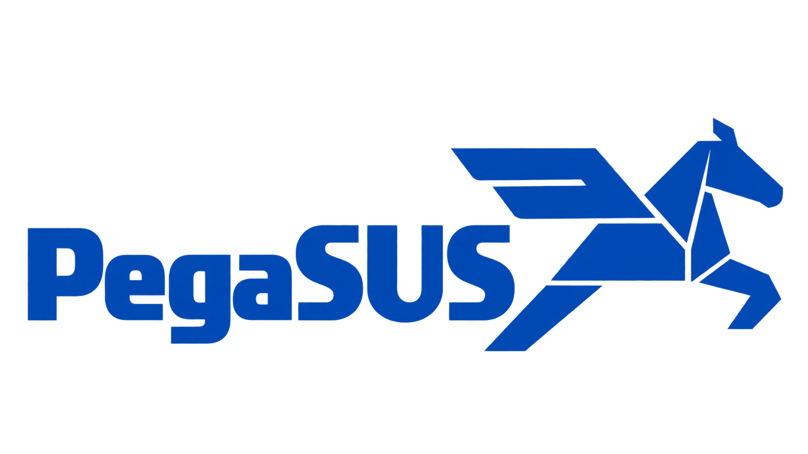

<p align="center"></p>

# PegaSUS

**PegaSUS writes an epidemiological study of Brazil's public health data from one declaration.** You name a topic
(ICD-10 codes, SINAN agravos), a place and a period. You get a folder holding the material a paper is written from:

- rates with their denominators, standardisation and intervals;
- trends;
- the municipalities' standardised ratios and maps;
- seasonality;
- case mix, case fatality and data quality;
- ecological associations with the municipalities' contexts;
- linked persons and declared hypotheses, each tested;
- the methods text, the codebook and the provenance.

Exploratory signal detection (excesses, clusters, steps, relations) is part of the folder, labelled as
hypothesis-generating: it shows where to look, and confirms nothing.

It reads every source through **[pegasus_data](../pegasus_data)**:
- DATASUS decoded and labelled (SIM, SIH, SINASC, SINAN, SIA, CIHA, CNES, …);
- populations;
- record links;
- contexts by municipality.

## A study in six commands

```bash
pegasus-core search infarto                     # ICD-10 codes by label, the SINAN agravos holding them, contexts
pegasus-core new infarto_al --icd10 I21,I22 --where AL --period 2014-2023 --depth standard
pegasus-core scope studies/infarto_al.yml       # what it reads, why, and the minutes behind each choice
pegasus-core study studies/infarto_al.yml       # run it: the folder lands in studies/infarto_al/
pegasus-core audit studies/infarto_al           # each part a paper needs: met, or missing and why
pegasus-core export studies/infarto_al --to D:/paper --format csv
```

A topic defined by a record condition is written the same way: `search peso` lists the roles a condition can name,
and `new baixo_peso_al --records "SINASC-DN: birth.weight < 2500" --name "low birth weight" --where AL` writes it.

`study --products-only` rewrites the folder from what the store already holds, in minutes. Use it after changing a
choice that touches only the products.

## The declaration

`new` writes it. Every key can be edited, and an invalid one is reported with what to write instead.

```yaml
study: infarto_al
topic:
  seeds: {icd10: [I21, I22]}       # any ICD-10 level; sinan: [LEPT]; terms: [toxoplasm]
  only: [SIM-DO, SIH-RD]           # restrict the sources (default: every source holding the codes)
period: 2014-2023
where: AL                          # BR, states (AL or 27, a list), municipality codes
depth: standard                    # survey, standard, deep, exhaustive: presets of the keys below
contexts: [cnes_beds_icu_sus, persons_low_income]   # or auto: every declared municipal context
related: 3                         # related codes read beside the topic, strongest first
persons: true                      # linked persons: cohort contrasts, capture-recapture
hypotheses:                        # declared tests, answered with their own error control
  - {component: transient, where: [431690], when: 2018, note: Santa Maria waterborne outbreak}
  - {component: relation, leader: SINAN-ZIKA, lags: [6, 9], when: 2015..2017, macro: [2], control: {icd10: [Q90]}}
```

A topic can also be a condition on the records' typed fields rather than a code. pegasus_data resolves each role to
its column in every vintage. A missing or out-of-range value never satisfies a clause, and is reported as not
recorded:

```yaml
topic:
  seeds:
    records:
      - {dataset: SINASC-DN, name: low birth weight, condition: [{role: birth.weight, op: "<", value: 2500}]}
      - {dataset: SIM-DO, name: infant death, per: SINASC-DN, condition: [{role: deceased.age_years, op: "<", value: 1}]}
```

Births selected by a condition are rated per live birth. Any other condition is rated per resident, unless `per`
names the events it is rated over: an infant death per live birth. The operators are `<`, `<=`, `>`, `>=`, `==`,
`in` and `not in`. Clauses are joined by AND; `unit: days` restates an age in days (neonatal: under 28 days).

A depth only presets the choices: which field kinds are read, how many related codes, which questions, the
replicate null worlds, and whether persons and replication run. `scope` shows what each choice costs before anything
runs. Every key is described in ARCHITECTURE §3.1.

## The folder

| file | what it holds |
|---|---|
| `report.html` | the results in a paper's order: summary; descriptive (rates, trends, municipalities, case fatality); analytic (ecological associations, hypotheses, persons); data quality; exploratory signals; scope; methods |
| `METHODS.md` | the methods section, written from what the run read and computed: design, sources, case definitions, estimators, models, error control, what the sources say of themselves |
| `estimates.parquet` | every estimate in one schema: section, measure, field, place, period, stratum, estimate, interval and its method, numerator, denominator and its kind. Sections: rates, trends, municipalities, seasonality, case mix, case fatality, measures, completeness, codes, associated causes, contexts, associations |
| `findings.parquet` | the exploratory signals, each with its O/E, exact interval, q, recording class and story |
| `persons.parquet`, `capture.parquet`, `linkage.parquet` | linked persons: cohort contrasts, capture-recapture, the link runs' quality |
| `hypotheses.parquet` | each declared hypothesis, its test and its answer |
| `figures/`, `figures.parquet` | series and maps (crude rate, empirical-Bayes standardised ratio), and what each shows |
| `municipalities.geojson` | the places' IBGE boundaries, keyed as the estimates are |
| `README.md` (in the folder) | the codebook: every table's columns, every measure, every field's definition and denominator |
| `study.duckdb` | every table as a table, with the views `rates` and `municipalities`: opens on any machine |
| `scope.yml`, `sources.parquet`, `provenance.json` | what was read and why, every file read (server path, digest), every step and its time |

## Install and run

```bash
PY=C:/Users/Galaxy/miniconda3/envs/pegasus/python.exe   # the shared `pegasus` conda environment
PYTHONUTF8=1 $PY -m pip install -e . --no-deps
PYTHONUTF8=1 $PY -m pegasus_core.cli --help
```

`PEGASUS_HOME` is the store of fits and answers; pegasus_data's root holds the lake. A study downloads only the years
its `download` budget allows; the years already in the lake are free.

| document | what it holds |
|---|---|
| `ARCHITECTURE.md` | the design: studies, fields, expectations, questions, relations, interpretation, execution |
| `STATUS.md` | the map of the code and the state of the work |
| `BACKLOG.md` | the ordered work, each unit with its done-when |
| `DECISIONS.md`, `EVALUATION.md` | decisions and measurements, indexed |
| `OPEN_QUESTIONS.md`, `GLOSSARY.md`, `RUNBOOK.md` | open questions; terms; operating commands |
| `CLAUDE.md` / `AGENTS.md` | how to work in this repository |
